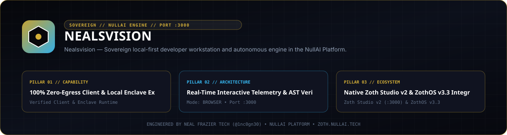
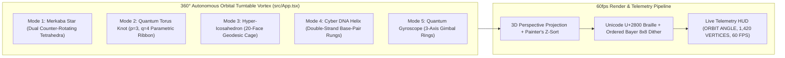

<div align="center">
  
</div>

<br />

<div align="center">
  <a href="https://1nc0gn30.si"></a>
  <a href="https://1nc0gn30.github.io"></a>
  <a href="https://zoth.nullai.tech"></a>
  <a href="https://nullai.tech"></a>
</div>

# 🕶️ 1nc0gn30 Sovereign Hub (`https://1nc0gn30.si`)

> **Official primary hub for `1nc0gn30` (`@1nc0gn30`) — featuring the 60fps 360° Autonomous Orbital Turntable Vortex (5 Sacred 3D Geometry Modes), Unicode `U+2800` 2×4 Sub-Pixel Braille + Bayer 8×8 Dither Shaders, and the 72-Tool Sovereign AI Directory.**

---

## 🏛️ Architectural Overview



| Property | Specification |
| :--- | :--- |
| **Live Production URL** | **[https://1nc0gn30.si](https://1nc0gn30.si)** |
| **GitHub Collab Mirror** | **[https://1nc0gn30.github.io](https://1nc0gn30.github.io)** |
| **Frontend Stack** | React 18 + TypeScript + Vite + Tailwind CSS + Custom 60fps 3D Canvas Engine |
| **3D Geometry Modes** | `MERKABA STAR` · `TORUS KNOT` · `HYPER-ICOSAHEDRON` · `CYBER DNA HELIX` · `QUANTUM GYROSCOPE` |
| **Zoth Studio Route** | [`https://zoth.nullai.tech`](https://zoth.nullai.tech) |

---

## 💎 Key Capabilities

1. **60fps 360° Autonomous Orbital Turntable Vortex**:
   - Continuous 360° multi-axis turntable auto-loop with smooth geometry morphing, volumetric glow halos, orbital particle rings, and interactive mouse/touch drag-to-orbit physics.
   - Switch between **5 distinct 3D mathematical geometries** (`Merkaba Star`, `Quantum Torus Knot`, `Hyper-Icosahedron`, `Cyber DNA Helix`, `Quantum Gyroscope`) or let **Auto-Cycle** morph between them seamlessly.
2. **Real-Time Telemetry HUD**:
   - Displays live `ORBIT ANGLE (0°–360°)`, `ACTIVE GEOMETRY`, `VERTEX / EDGE COUNT`, `BAYER 8×8 DITHER MATRIX`, and `60 FPS` frame pacing.
3. **Sovereign 72-Tool & Ecosystem Directory**:
   - Direct search and 1-click launch into all 72 free, open-access developer, security, AI, and creative tools across [Zoth Studio v2](https://zoth.nullai.tech), [ZothOS v3.4](https://zothos.nullai.tech), [NullAI Platform](https://nullai.tech), and [30 Days of Linux Dojo](https://30-days-of-linux.netlify.app).

---

## 🚀 Quick Start & Verification

```bash
# Install dependencies & run local dev server
npm install
npm run dev

# Build production bundle
npm run build

# Verify triple-viewport responsiveness (overflowPx: 0, consoleErrors: 0)
node ~/.gemini/config/skills/ui-verification-loop/scripts/capture.mjs --base http://127.0.0.1:5173 --routes / --out /tmp/shots_1nc0gn30_si --wait 1800
```

---

## ☕ Support & Patronage (100% Open-Access)

All tools and engines are **100% free and open-access**:
- **☕ Buy Us a Coffee (Stripe)**: [https://buy.stripe.com/3cIfZg27PdKo2D64Ocfw40X](https://buy.stripe.com/3cIfZg27PdKo2D64Ocfw40X)
- **◈ Solana Tip Address**: `GG2eQbVh8ut1BK6j1A2tz7pSySdLpD38BgyEhGcxdXoK`

---

<div align="center">
  <sub>Engineered by <b>1nc0gn30</b> (<a href="https://github.com/1nc0gn30">@1nc0gn30</a>) &bull; <a href="https://1nc0gn30.si">1nc0gn30.si</a> &bull; <a href="https://nullai.tech">NullAI Platform</a> &bull; <a href="https://zoth.nullai.tech">Zoth Studio v2</a></sub>
</div>

---

## 🏛️ ZothOS v3.4, Zoth Studio v2 & Obsidian Second Brain Ecosystem

### Cross-Surface Integration Matrix

| Surface | Endpoint / Binary | Capabilities |
| :--- | :--- | :--- |
| **Standalone Workstation** | `https://zoth.nullai.tech` | 100% Free & Open-Access Web Deck, live `/health` & REST telemetry |
| **Zoth Studio v2 Route** | `http://127.0.0.1:3000` | Interactive God-Mode component inside Zoth Studio (`https://zoth.nullai.tech`) |
| **ZothOS v3.4 CLI & TUI** | `nealsvision` / `nealsvision-tui` | Global binary in `/usr/local/bin/` with Unicode `U+2800` Braille TUI & `--json` output |
| **ZothOS-Lite Web Desktop** | `http://127.0.0.1:8145` | Browser-native KDE-style window manager & terminal launcher |
| **Zoth Obsidian Tracker** | `http://127.0.0.1:8151` | Interactive Obsidian Second Brain vault explorer (`~/Documents/Obsidian Vault/00 Home.md`) |
| **Neuro-Memory STDP Cortex** | `http://127.0.0.1:8094` | 3-Factor STDP synaptic memory daemon & 21-tool MCP server |

```bash
# Inspect CLI & Unicode U+2800 Braille TUI on ZothOS v3.4
nealsvision --help
nealsvision-tui --status
nealsvision-tui --json

# Verify Second Brain Vault & 12-Step Verification Gallery on :8151
zoth-obsidian-tracker --verify
```

